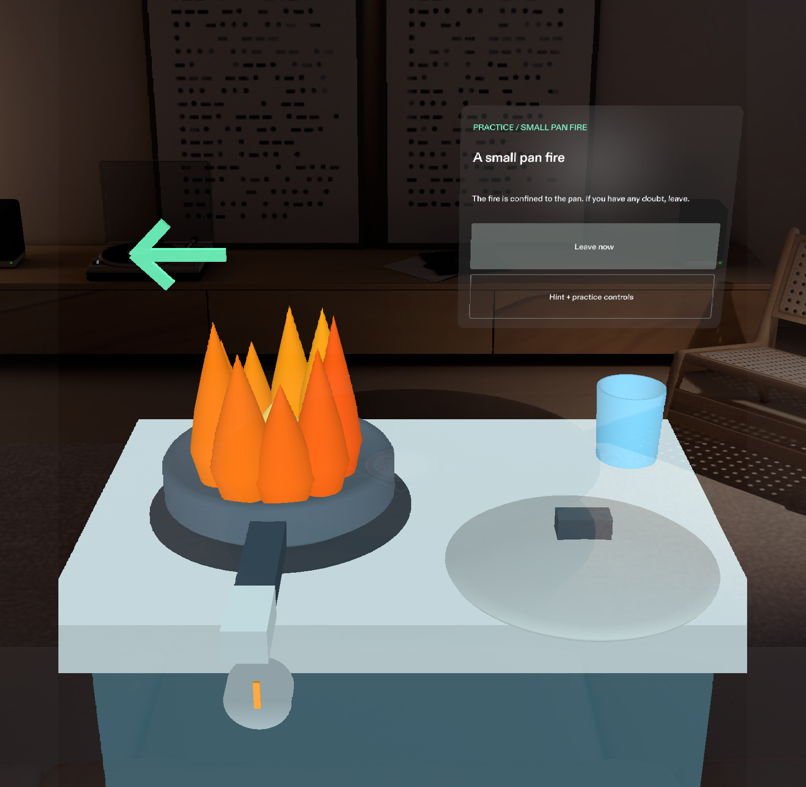
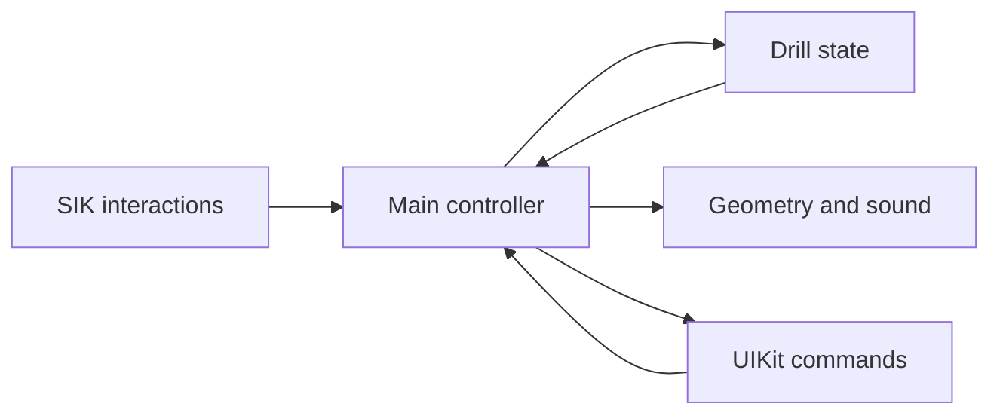

# Two Minutes: Know When to Leave

A SPECS practice drill about a kitchen fire and the decision to leave.

Two authored situations use the same kitchen. One fire is confined to a pan. The other has already spread beyond it. The learner can slide the virtual lid, switch off a safely reachable burner or leave through a marked virtual exit. Leaving is always accepted. The debrief explains what the learner actually did.

The name describes a short practice session. It does not promise two minutes of safe escape time.



Verified locally: 23 portable tests, seven native LEAF cases and automated preview interactions for containment and evacuation. See the [verification record](devpost/native-validation.md) for evidence and limits.

[Watch the narrated demo](https://www.youtube.com/watch?v=WuJgiFBuOKA) | [Devpost project](https://devpost.com/software/two-minutes-know-when-to-leave)

## Run the Lens

1. Install [Lens Studio 5.23.2](https://ar.snap.com/download/v5-23-2) or a compatible later version.
2. Open `TwoMinutes.esproj` from this folder. Keep `Assets/` and `Packages/` beside it.
3. In Preview, use SPECS 27 and Interactive Preview. Choose Evening Room for the demonstrated contrast. Look down toward the cooktop with right-drag.
4. Choose a scenario. Click a control to simulate a pinch. Use WASD to move, Q/E to move down/up and right-drag to look around.
5. Try leaving first. Then reset and compare the small-pan containment sequence with the spreading-fire scenario.

No glasses or household objects are needed for the preview. The kitchen and exit are virtual. No real call is placed.

## Check the logic

Use Node.js 22.18 or later:

```sh
npm ci
npm test
npm run typecheck
```

The portable suite has 23 passing tests across the state machine and view models. Two tests explore every choice sequence up to five actions, with finished branches pruned: 33,476 action prefixes in total. They check that an active drill always allows evacuation, water never earns a containment result, the door step cannot block calling from outside and a finished result cannot change after a late click. The view tests check truthful recovery feedback and bounded debrief text.

These tests establish state transitions. Native compilation, interactions and layout are separate checks, recorded in [native validation](devpost/native-validation.md).

## What the drill teaches

- A spreading fire calls for leaving. The lid and burner cannot solve that scenario.
- A small pan fire has an illustrated containment branch: slide a lid from the side, switch off the heat if safely reachable and keep the pan covered until fully cool.
- Water triggers an authored consequence and an evacuation path. It has no spectacular reward.
- The learner can leave at any point, then make a simulated call for help from outside. Closing the door is available when safe.
- The pan cannot be picked up or carried. There is no speed score or safe-time countdown.

The script draws on [CPSC, NFPA and USFA guidance](devpost/safety-sources.md). This prototype has not been reviewed by a fire educator or shown to improve emergency behavior. It does not detect real fires or find safe routes through a real building.

## How it is built

`TwoMinutesState.ts` owns the decisions. The main controller sends it actions and sends the resulting state to the geometry and passive UIKit views. SIK handles targeting, pinching and lid manipulation. MeshBuilder creates the articulated cooktop, pan, lid, flames and exit beneath authored scene roots. Five generated sound cues mark actions and transitions.



Planning used the Devpost Learn `plan-lens` skill. The build follows Snap's CLAD skills and uses the Lens Studio MCP for package import, scene assembly, compilation and preview checks. The [toolchain notes](devpost/toolchain.md) record the original template, dependencies and build process.

## Project files

| Path | Purpose |
| --- | --- |
| `TwoMinutes.esproj` | Lens Studio project |
| `Assets/Scripts/` | State, scene, interaction and UI modules |
| `Assets/GeneratedSFX/` | Generated drill cues and manifest |
| `Packages/` | Snap SIK and UIKit packages |
| `tests/` | State tests and bounded safety checks |
| `devpost/design-brief.md` | Approved scope and six done criteria |
| `devpost/demo-script.md` | Demo sequence and narration |
| `devpost/native-validation.md` | Native build evidence and remaining gaps |
| `demo-video/` | Narration script, captions and local video-production scripts |

The demo is public on YouTube, and the Devpost project page has the video and gallery. The hackathon entry has not been finally submitted. A public source repository and the participant's required form answers remain before entry into [Learn AR with SPECS](https://learn-specs.devpost.com/). The official deadline is November 9, 2026 at 2 PM Pacific.

## Credits

This is new project code built during the hackathon. It starts with Snap's official Specs Base Template and includes the standard SIK and UIKit packages. See [toolchain and attribution](devpost/toolchain.md) and [the sample license](SPECS-SAMPLE-LICENSE.md).
